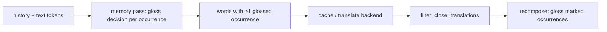

# Architecture


## Memory model
Whether an occurrence gets glossed follows a Pavlik & Anderson (2005) trace model, run in reading order over `--history` then the input:
```
ρ_x          = f_x / f_K                        f_K = 1/K^s (K = -w, s = per-language Zipf exponent); x = form or its lemma
s_xy         = k · END(x, y)                    k = --lemma-credit
ρ            = ρ_form^(1−s) · ρ_lemma^s         s = s_form,lemma, if ρ_lemma > ρ_form, else ρ = ρ_form
ρ_perceived  = ρ + A · Σ_j w_j · (t - t_j)^(-d_j)  t in tokens; one impulse per previous sighting of any form of the lemma
w_j          = 1 for the same form, s_form,form_j for another form
d_j          = a + c · ρ_perceived(t_j⁻)         set when sighting j happens
A            = Δ1^a                             a brand-new word's single sighting holds Δ1 tokens
gloss iff ρ_perceived < 1
```
END is Jaro-Winkler taken at the better of two alignments: start-aligned (plain JW) and with the shorter word aligned to the longer one's end, so a stripped prefix still matches (ел/поел: JW 0, END 0.87). It's used only between forms of one lemma: on unrelated strings, containment alone scores high (nsa/mensa).

The lemma credit is interpolated in log-frequency (rank) space, the space the `-w` threshold lives in: s=0 is the form on its own, s=1 the lemma's rank. A form wordfreq never listed counts at wordfreq's floor frequency.

Power-law traces have no short/long-term boundary to pick, and making `d_j` grow with the familiarity present at sighting time is what credits spaced repeats over massed ones.
