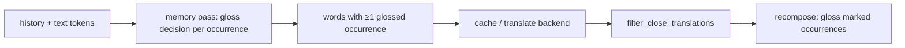

# Architecture


## Memory model
Whether an occurrence gets glossed follows a Pavlik & Anderson (2005) trace model, run in reading order over `--history` then the input:
```
ρ            = f_w / f_K                       f_K = 1/K^s (K = -w, s = per-language Zipf exponent)
ρ_perceived  = ρ + A · Σ_j (t - t_j)^(-d_j)     t in tokens; one impulse per previous sighting
d_j          = a + c · ρ_perceived(t_j⁻)        set when sighting j happens
A            = Δ1^a                            a brand-new word's single sighting holds Δ1 tokens
gloss iff ρ_perceived < 1
```
Memory is keyed by the lemma of the lowercased token, and `f_w = max(f(lower), f(lemma))`.

Power-law traces have no short/long-term boundary to pick, and making `d_j` grow with the familiarity present at sighting time is what credits spaced repeats over massed ones.
